# Claude mode (dsh-claude-mode)

A pure-slot Claude Code-style interaction layer for DeepSeek Harness: a neutral-grey + terracotta theme pair, a pulsing status star, a command palette, rotating turn-completion footers, and keyboard-first flows. No host files are edited and the app root is never replaced; disabling or uninstalling restores the previous theme and removes every widget.

1.1.x upgrades the Prompt Pilot from a short-ghost hint into **complete prompt collaboration**: with an empty composer it first writes a local draft with goal, known context, scope, constraints, execution and acceptance checks, and displays the whole draft in a multi-line card; with AI completion enabled it sends the same bounded context to the current Session model (the deployment default when the Session has not recorded a selection) to rewrite a fuller, more executable next prompt. One call per context, cached on both client and Host; with AI off or the model unavailable, the complete local draft remains. A typed prefix still completes as ghost text. Both accept with `Tab` and dismiss with `Esc`. 1.1.x also adds **Data & storage** (read-only audit, migration/cleanup scripts) and a **whole-sidebar scroll override** so expanding every plugin icon cannot hide the workspace. See [the design notes](docs/DESIGN.md).

**Prompt Pilot evaluation**: `npm run eval:pilot` runs 30 Chinese/English context cases plus length/goal-and-acceptance/re-offer/context-budget/latency checks, and a fake `llm` harness for the Host AI route (auth, 32KB body limit, context clipping, 1600-token output budget with lowest reasoning effort and a doubled-budget retry, cache, rate limit, failure fallback). Currently **30/30 local cases + 18/18 route contracts** pass; local generation is ~0.01ms per call. The AI path makes at most one model call per context; local generation uses 0 tokens and 0 network. `npm run eval:data` additionally exercises the real-file-system audit plus migration/cleanup route contracts without moving or deleting anything. Full report: [docs/PROMPT-PILOT-EVAL.md](docs/PROMPT-PILOT-EVAL.md).

> Independent implementation built only on DeepSeek Harness public slots and services. It bundles no third-party source code, trademark, icon, or artwork; the palette and interactions are this plugin's own presentation layer and it is not affiliated with Anthropic. See [NOTICE](NOTICE).

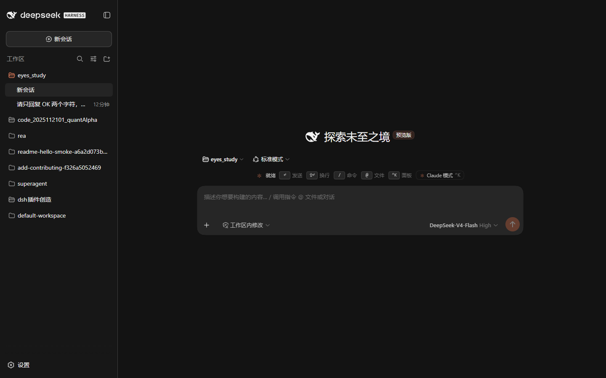

## What ships

| Capability | Slot / service | Behavior |
| --- | --- | --- |
| Dual theme | `theme.overrideTokens` token layer | Two ~200-token `--dsw-*` packs (neutral charcoal / neutral light). Brand `#d77757`, user bubble `#373737/#f0f0f0`, composer `#262626/#f5f5f5`, selection `#264f78/#b4d5ff`, state and diff colors come from the plugin's unified design tokens. Token-only override; no host CSS is touched. |
| Run status bar | `conversation.input.dock` | Idle hints (`↵ send · ⇧↵ newline · ↑ history · / commands · @ files · ⌃K palette · ? shortcuts`); while running: `✻ <verb>… (esc to interrupt · 12s · running tool for 3s)` — a six-frame Unicode star pulsing forward and back over two seconds (100 ms refresh), plus live tool duration from the Chat snapshot. |
| Prompt history | run-bar keydown + command palette | With an empty composer, `↑` recalls previous prompts and `↓` moves newer / restores the saved draft (finalized user/steering nodes from the Chat snapshot, deduped, newest first). The `⌃K` palette adds a "Prompt history" group (12 most recent, fuzzy-searchable, selecting fills the composer). |
| Inline prompt completion | `conversation.input.overlay` | **Prompt Pilot**: with an empty composer, reads the newest assistant reply, recent tool output, last prompt and Session title, then writes a **complete local draft** (goal, known context, scope, constraints, execution, acceptance/verification) and shows it in a multi-line card. With **AI prompt completion** on, the same bounded context goes to the current model for a fuller, more executable next prompt; one request per context with client and Host caching, and the complete local draft remains when AI is off or unavailable. Shows after a 350 ms focus dwell; `Tab` accepts, `Esc` dismisses, **deleting an accepted draft re-offers it**. A ≥2 character prefix still completes from history. `/`, `@`, a running turn, or a host menu suppress it. |
| Shortcut sheet | `shell.overlay` | With an empty composer, `?` (or the palette action) opens a sheet grouped into Input / Navigation / Interface; `Esc` or the backdrop closes it. Matches Claude Code's `? for shortcuts`, which only triggers on empty input. The sheet now lists `Alt+N` too. |
| Chat-history search | `sessions.search` + palette | Typing at least two characters in `⌃K` debounces a call into the host's full-text session index; hits appear under "Chats" with a snippet and `↵` opens that session. `Alt`/closing aborts the request and a 12-second timeout clears the loading state. The host's `session-query-sqlite` defaults to `openAt: never`, so this group only returns rows when the deployment enables the index; otherwise it silently disappears. |
| Read-aloud | `conversation.chat.assistant-actions` | Every finalized assistant message gets a speaker button in its action strip. It reads the message prose with the Web Speech API and toggles to Stop; Chinese/English follows the UI locale and long replies are chunked into ≤1200-character utterances. Browsers without speech synthesis omit the button. |
| Completion chime | run-bar transition + settings | When a running turn ends and the toggle is on, a two-note WebAudio chime (E5→B5) plays, audible even with the window unfocused. Off by default; preview in Settings and toggle from the palette. Playback failures are swallowed. |
| New-session shortcut | `uiWorkspace.startSession` + global key | `Alt+N` opens a blank session from any non-modal screen, equivalent to the palette's "New session"; the shortcut sheet and Settings list the binding. |
| Collapsible sidebar | `layout` service | The run-bar `«` button, the palette action, and `Alt+B` call `ctx.layout.toggleSidebar()`; the host then renders its 56 px control rail so the sidebar stops eating conversation width. |
| Whole-sidebar scrolling | scoped host-sidebar override | When the host sidebar is a fixed-height column, many expanded plugin icons push the workspace/session area out of view. The plugin makes `sidebarCol` scroll as one column, keeps a 280 px workspace floor, and otherwise preserves the normal fill layout, so the session tree and the account footer remain reachable. |
| Folding plugin icons | `sidebar.panellist.actions` | Too many plugin icons above the workspace list squeeze the session list. A new "Plugin icons" section in the sidebar's More menu adds per-icon Show/Hide, one-click Collapse all / Expand all, and an `N/M shown` count; hidden icons stay in that menu and can be restored. The palette also offers "Manage sidebar plugin icons". |
| Command palette | `shell.overlay` | `Ctrl+K` / `⌘K`: fuzzy search, grouped sections (appearance / interaction / session / chats / history), ↑↓·Tab/Enter/Esc, hover and click, backdrop close. Actions: mode toggle, three theme choices, status-bar/footer/motion/sound toggles, sidebar toggle, plugin-icon manager, shortcut sheet, interrupt, new session; two or more characters also search chat history. |
| Turn footer | `conversation.chat.turnTail` | `✻ Baked for 1m 2s · 3 steps`; the completion word rotates per turn through `Baked / Brewed / Churned / Cogitated / Cooked / Crunched / Sautéed / Worked` (or `烘焙/酿造/搅拌/推敲/烹饪/咀嚼/煸炒/打磨` in zh). Registers against both the modern list slot and the older chain slot. |
| Header button | `conversation.session.header.utilities` | Top-right `✻` opens the palette; accented while running. |
| Settings page | `settings.section` + `settings.section.icon` | Master switch, theme segment, widget/motion/sound toggles, inline completion, empty-composer context suggestions, AI prompt completion, sound preview, shortcut reference, reset, about/version. The AI switch explains that one call per context is cached and that turning it off leaves the local template only. |
| Data & storage | `settings.section` + Host `/dsh-claude-mode/data` | Read-only scan of the DSH home (profiles/sessions/attachments/runtimes), Electron userData, updater cache, pnpm store/cache, npm cache, current TEMP and system TEMP. Each row shows `Managed` (junction) / `Still on C:` / `On another drive` / `Missing`, the physical target, C/E free space and a `≥` lower-bound size. A target root generates a `.ps1` migration script: stop DSH → robocopy → byte verification → park the original directory → create a junction → rollback on failure. TEMP gets a separate dry-run cleanup script for old `dsh-*`/`dsh_*` direct children. |
| Motion | component CSS/JS | Frame-by-frame star pulse, panel entrance, control transitions; respects `prefers-reduced-motion` and the plugin motion toggle (static `✻` when off). |

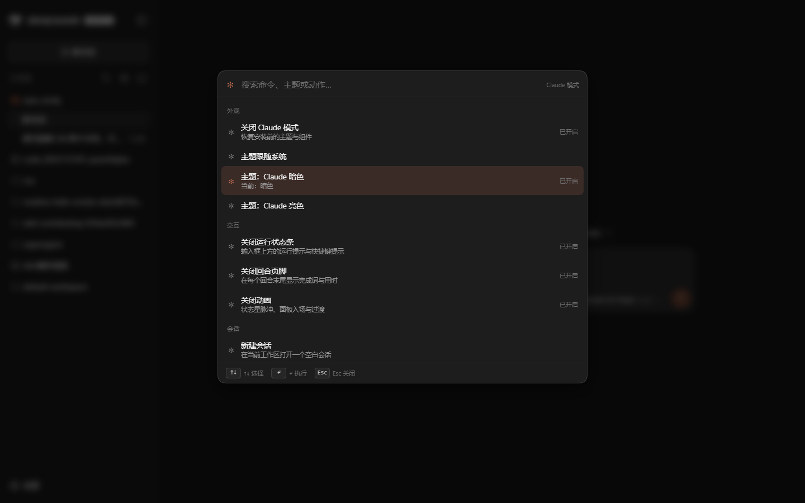

## Install

Ask the agent to install the local directory bundle:

```text
plugin_manager install_bundle, target = <absolute path to this checkout>
```

The bundle is written into the current profile (default `desktop`). Reload the Web GUI (or the desktop window) to see it; when upgrading from an older version, the Host half now owns the AI and data routes, so fully restart the DSH desktop app (or the `dsh web` server) before refreshing the page. Uninstalling removes the theme layer and every widget.

The directory is also a normal npm package: both `dsh.bundle.patch` and `dsh.client` are declared.

## Usage

- `Ctrl+K` / `⌘K`: command palette; type two or more characters to search chat history.
- `Alt+N`: open a blank session.
- With an empty composer, a complete local prompt card appears first; with AI completion on, it upgrades from "AI is completing…" to a fuller prompt written by the current model. Press `Tab` to accept, `Esc` to dismiss; blur or typing also dismisses. Delete an accepted draft and it appears again from cache without another model call.
- With a typed prefix, press `Tab` to accept the light inline completion.
- Local drafting, context extraction and acceptance ranking run in the browser. Only when AI completion is enabled and the cache misses is the latest reply, recent prompts and Session title sent to the current model. Statistics store only suggestion kinds/counts, never prompt text.
- Assistant read-aloud, completion sound, history recall and the command palette are unchanged.
- The speaker in an assistant action strip reads that reply aloud; click again to stop.
- Top-right `✻`: command palette.
- `esc to interrupt` in the run bar: cancel the running turn, keeping finished tool results and queued messages.
- Settings → Claude mode: switches, theme segment, completion-sound preview, reset.
- Settings → Claude mode → Data & storage: inspect which locations are already junction-managed and which still write to C:; enter a target root to generate a migration `.ps1`, then **fully stop DSH** and run it in a normal PowerShell. Never junction TEMP; use the cleanup script in dry-run first and add `-Apply` only after reviewing the list. The script parks the original directory as `*.data-keeper-<timestamp>` instead of deleting it.
- "Follow system" swaps between the neutral charcoal and neutral light packs with the OS scheme.

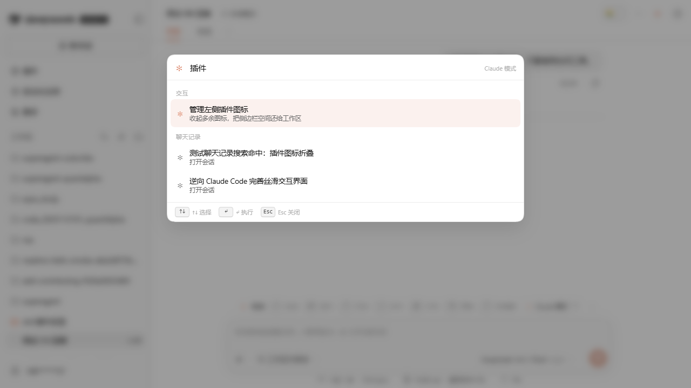

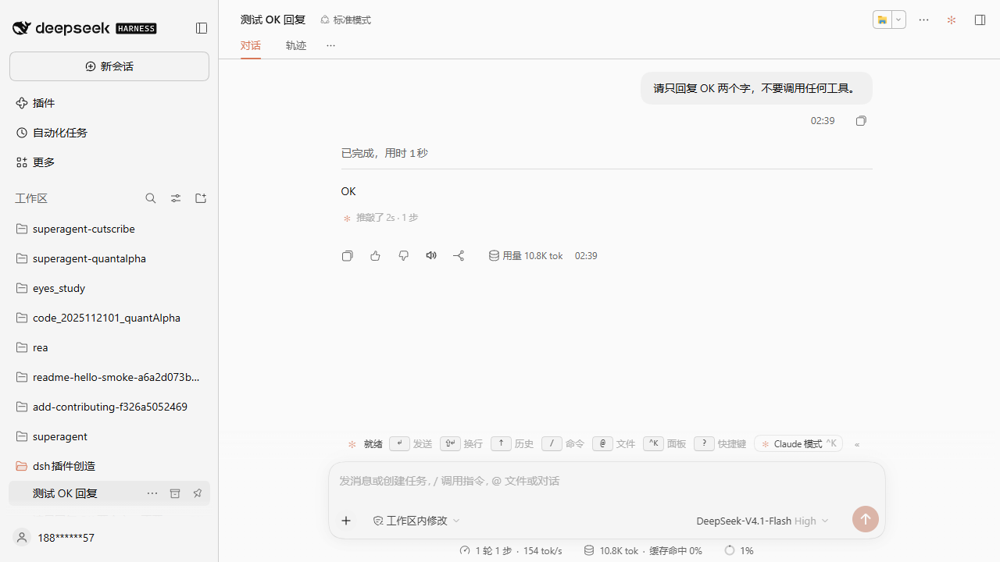

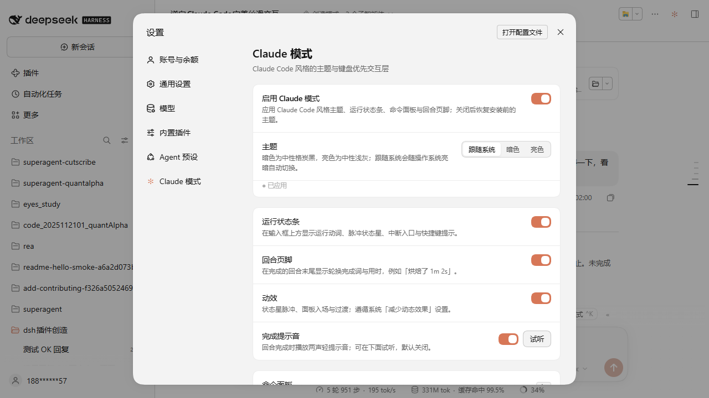

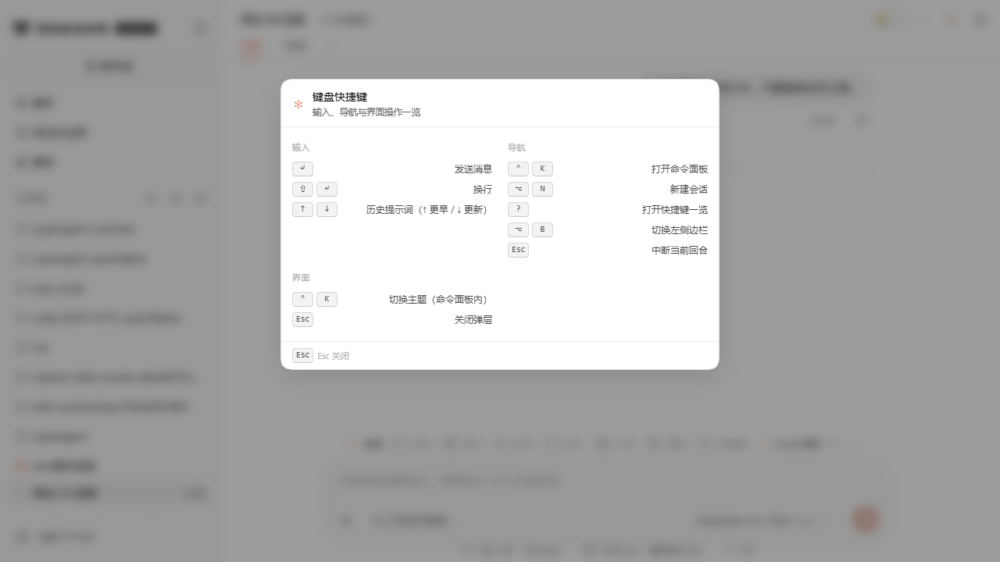

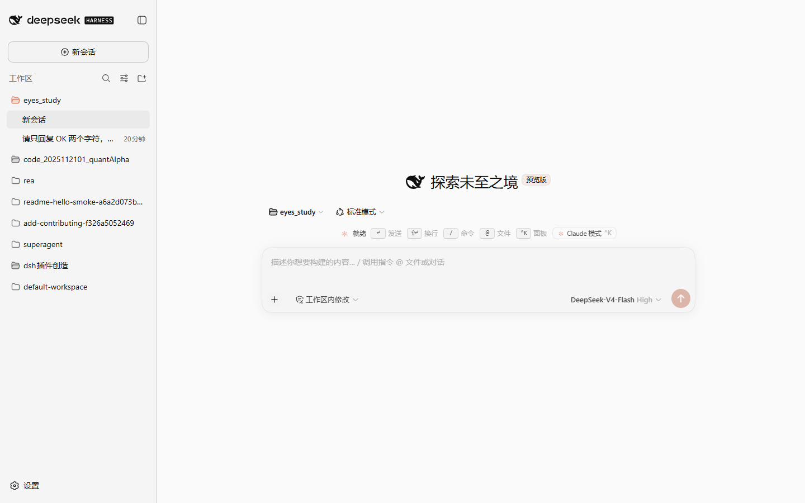

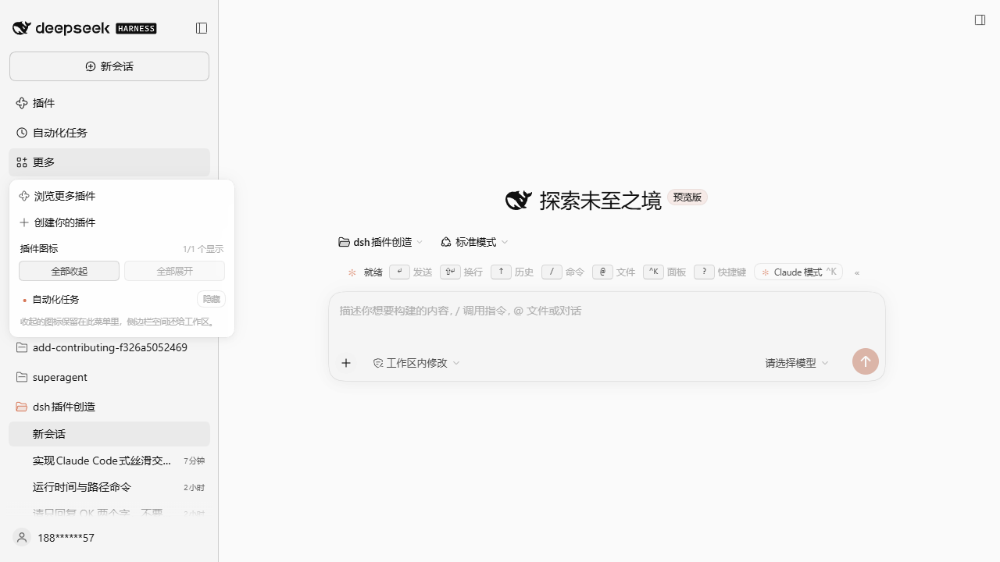

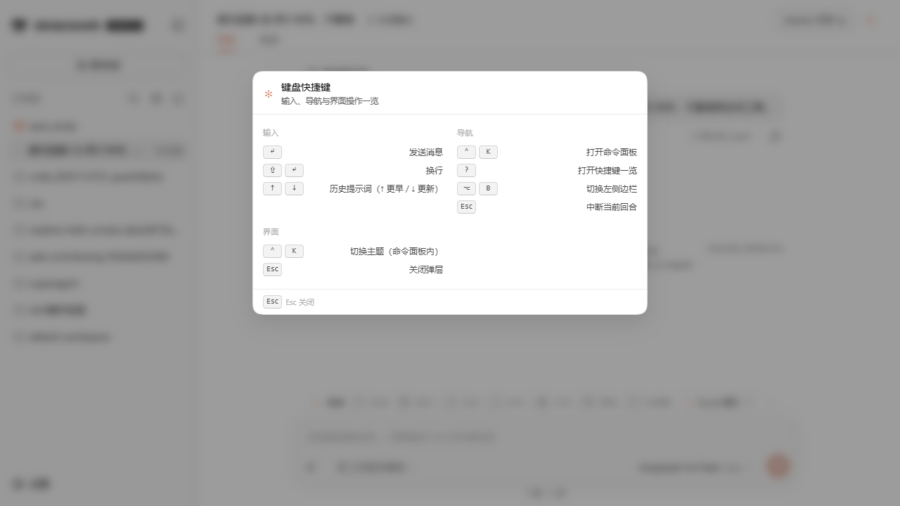

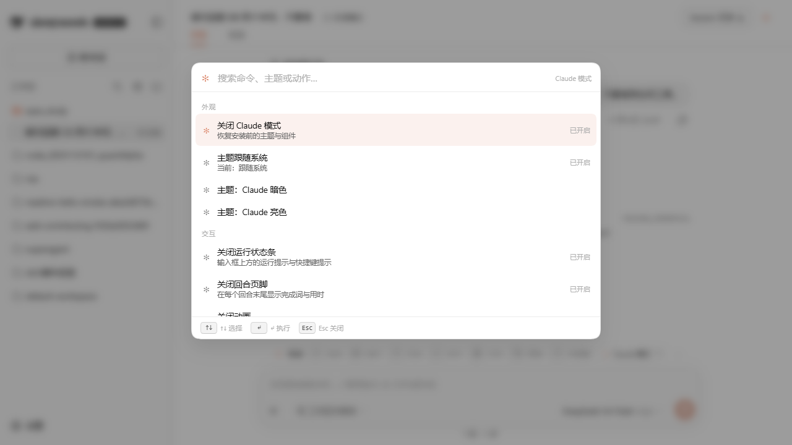

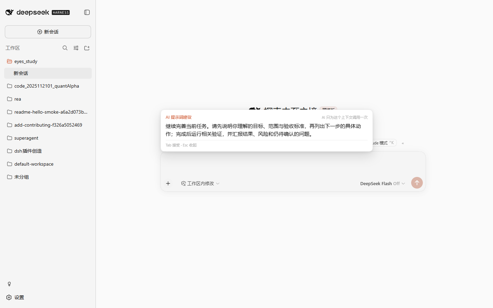

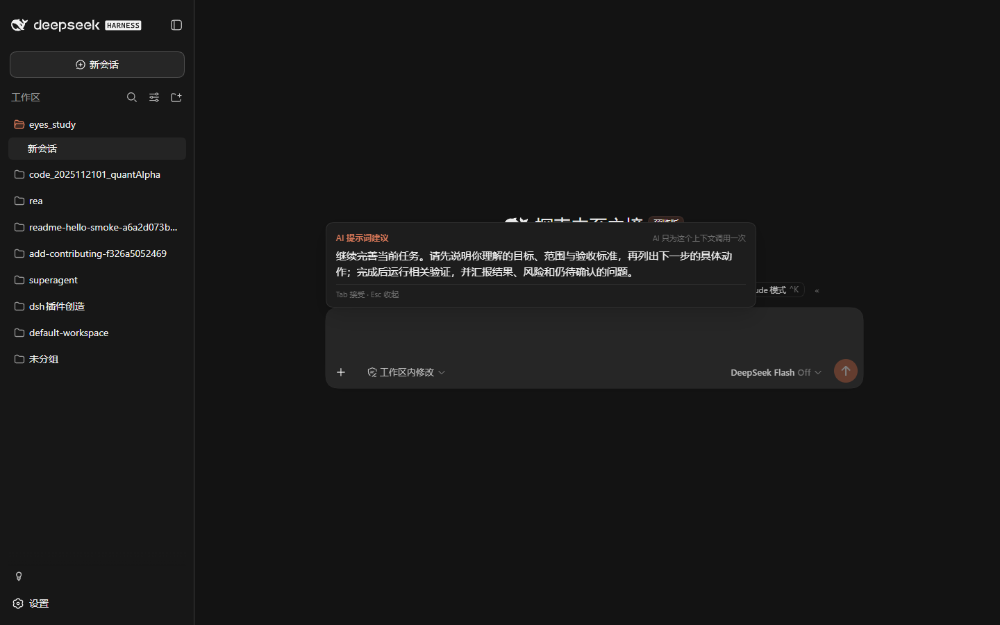

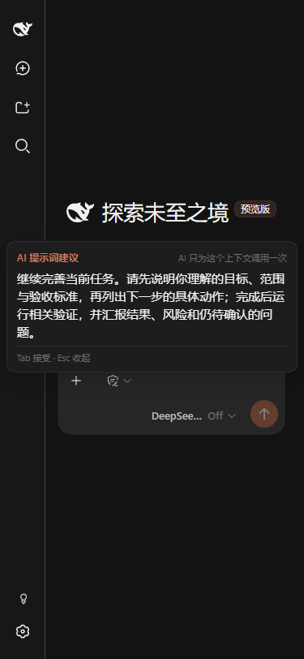

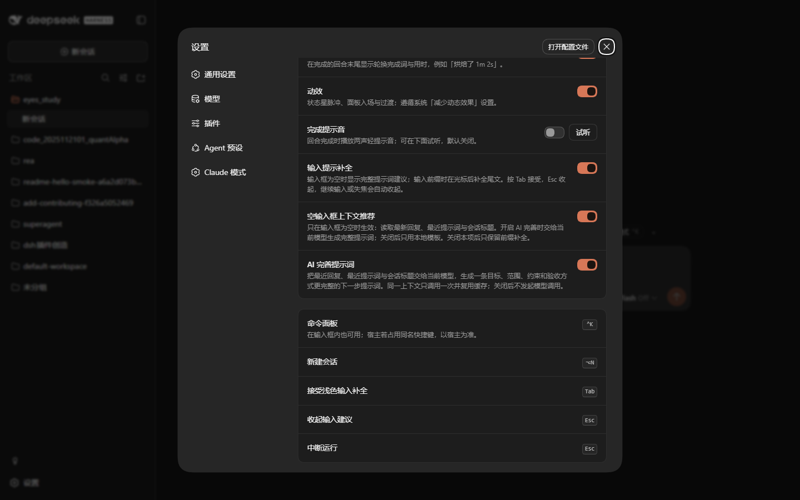

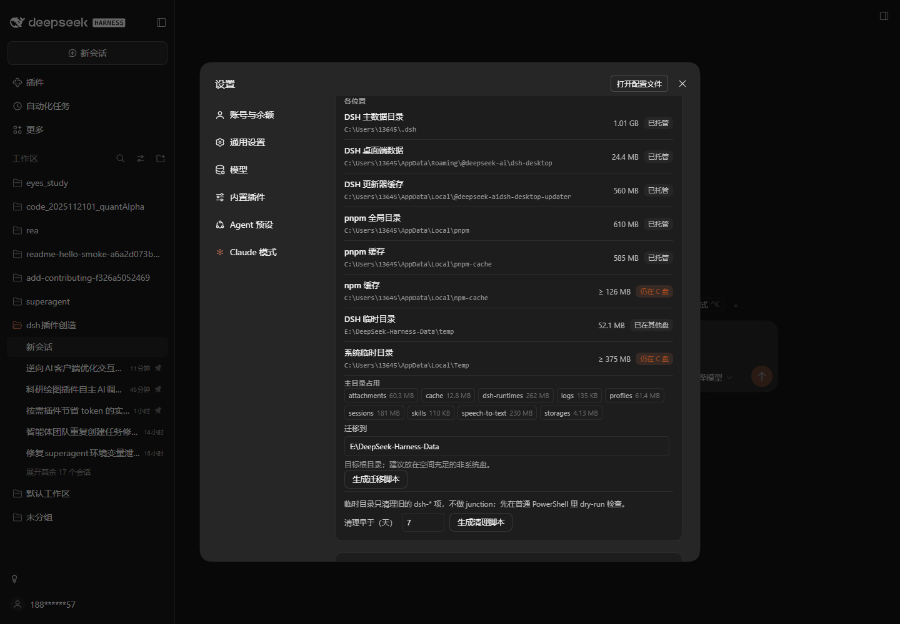

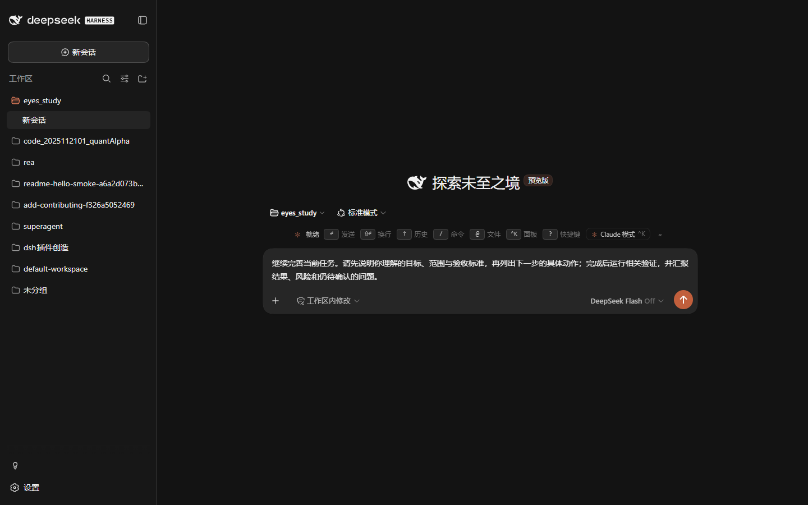

## Design rules

1. **Public extension points only**: the `theme` token layer; `conversation.input.dock`, `conversation.chat.turnTail`, `conversation.chat.assistant-actions`, `conversation.session.header.utilities`, `shell.overlay`, `sidebar.panellist.actions`, `settings.section` (+ icon); the `sessions.search` and `uiWorkspace` services; and the `locale` service. No occupied keyed slot is replaced.
2. **Reversible**: the theme is an override layer that is removed when the master switch is turned off; all widgets die with the plugin context.
3. **Never take over the conversation view**: chat nodes, tool cards, approvals, composer, and queue stay host-rendered.
4. **Accessible**: palette is a labeled modal, switches are `role="switch"`, segments use `aria-pressed`, the pulse honours reduced motion, and focus rings are visible.
5. **No brand assets**: the star is the Unicode character `✻` (U+273B); no Anthropic icon, font, or screenshot is bundled.
6. **Reviewable, reversible data operations**: the panel is read-only; migration is an external PowerShell script, never an in-process move of live data. It stops writes, robocopies, compares byte sums, parks the original directory instead of deleting it, then creates a junction and restores the original on failure. TEMP cleanup only targets old DSH-owned children and is dry-run by default.

## Known edges

- The conversation view is not replaced: thinking blocks, tool cards, diffs, and approvals remain host-rendered (which also keeps uninstall and host upgrades safe).
- AI prompt completion needs the Host `llm` service and a usable Session model (falling back to the deployment default). It sends the latest reply, recent prompts, tool output and Session title to the model provider the current Session uses. One call per context (client and Host caches for 10 minutes, 60-second failure cooldown); with the switch off, no model call is made and the complete local template remains. A new context counts as a new call.
- The complete card is fixed above/below the composer, wraps at 15px and scrolls inside a capped card; clicking it does not move focus out of the editor, and `Tab`/`Esc` only take over while it is visible.
- Data migration never runs inside the plugin: it only writes a reviewable `.ps1`. DSH must be fully stopped; the script robocopies, compares source/target byte sums, renames the original to `*.data-keeper-<timestamp>`, then creates a junction and restores the original if any step fails. Parked copies are left for manual deletion after verification.
- System TEMP is never junctioned: an ordinary DSH launch still writes there. The cleanup script only matches old `dsh-*`/`dsh_*` direct children, is dry-run by default, and keeps locked items.
- Junction targets must be on a local volume, must not already exist, and must not overlap the source; the script refuses to overwrite or merge an existing target.
- Upgrading from 0.9.x needs a full DSH restart (or `dsh web` restart) because the Host half now owns the AI and data routes.
- An approval/question card can temporarily occupy the composer area, hiding the run bar; the card itself offers allow/deny/stop.
- The `?` gesture only triggers on a focused, empty composer; with text present it stays a normal question mark. `Ctrl+R` (reload) and `Ctrl+S` (save) are not hijacked — prompt search lives inside the `⌃K` palette.
- The sidebar toggle needs the host `layout` service; without it the run-bar `«` button hides and the palette action degrades to a no-op.
- Whole-sidebar scrolling depends on the host sidebar structure: selectors match the `sidebarCol` class fragment and its `panelList`/`regionArea` parts. If a host rename removes them, the scroll override quietly falls back to the original layout; the rest of the plugin is unaffected.
- Plugin-icon folding needs the host's panel-pin plumbing: DSH 0.2.x exposes panel visibility and callbacks through `sidebar.panellist.actions`, so the plugin only adds a manager section to the More menu. Older hosts without that slot silently omit the section. The built-in More menu does not offer pin controls; this section adds that capability.
- Chat-history search needs the host full-text index: `sessions.search` only returns rows after a deployment changes `session-query-sqlite`'s `openAt` from `never` to `first-search` or `startup` (DSH ships it disabled and the Web sidebar searches titles/workspaces only). The plugin degrades silently, never fakes results, and shows "Searching chat history…" for at most 12 seconds while the first index build runs.
- Read-aloud needs browser speech synthesis; without `speechSynthesis` the button is absent. Voice and rate are chosen by the OS/browser; the plugin only prefers a voice matching the UI language. Changing message or unmounting cancels speech.
- The completion chime is off by default; a browser-suspended AudioContext fails silently and never affects the turn.
- `Alt+N` yields to any host binding that already handled the event.
- Settings live in the Web GUI origin; changing the `dsh web` port is a different origin and therefore a fresh settings scope.
- The theme layer needs the host `theme` service; without it the other widgets still work but keep the host colors.

## Development

```bash
npm run build:client   # generate client.js from src/client/*.js
npm run check          # syntax + bundle freshness
npm test               # 51 unit tests (tokens, i18n, store, ranking, word pools, frames, activity, history recall, chat-search mapping, read-aloud text/chunking, context extraction, complete drafts/diagnostic fallbacks, inline completion, shortcut sheet, panel-icon manager, settings page, renders, data audit/migration/cleanup plans, sidebar scroll)
npm run eval:pilot     # 30 local complete-draft cases + 18 Host AI route contracts + latency/context-budget/network audit, writes docs/PROMPT-PILOT-EVAL.md; no real model
npm run eval:data      # real-file-system data audit + migration/cleanup route contracts; moves and deletes nothing
node --check index.js && node --check client.js
```

## Compatibility

- Verified on **DSH 0.2.2-rc.1** (Desktop) and **0.1.2-rc.1** (`dsh web`); the turn footer registers under both slot declarations.
- Every dependency is a public slot or service. If a host rename happens, the affected widget degrades (disappears) instead of breaking the host.

## License

MIT. The interaction and visual layer are an independent implementation; "Claude" is used descriptively. See [NOTICE](NOTICE) and [the design notes](docs/DESIGN.md).


