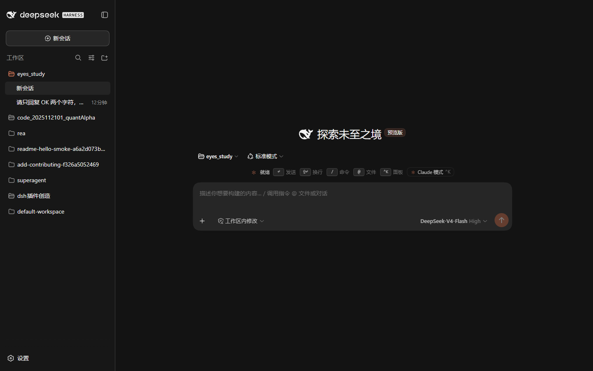
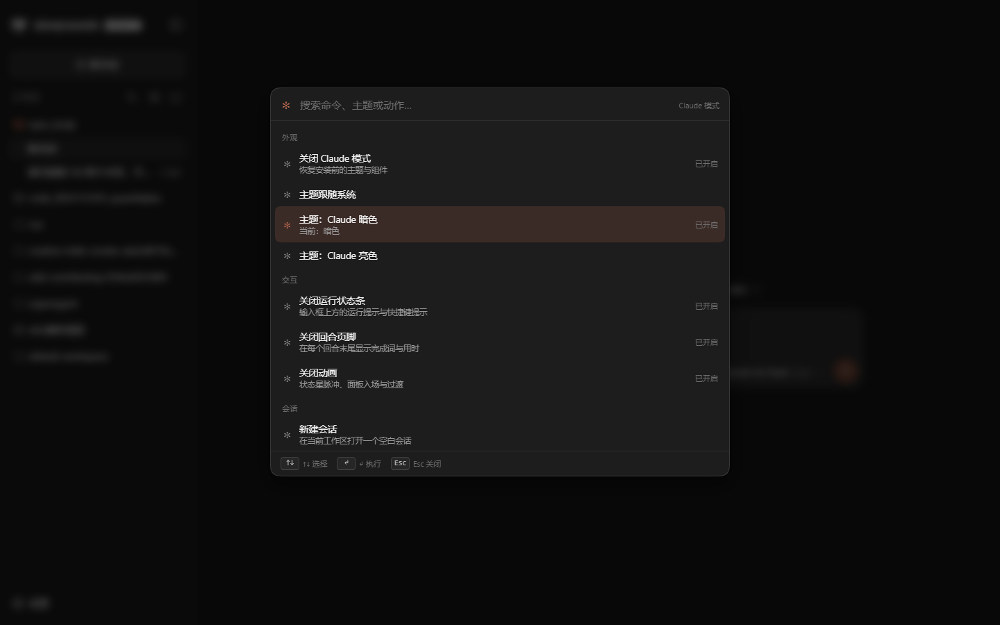
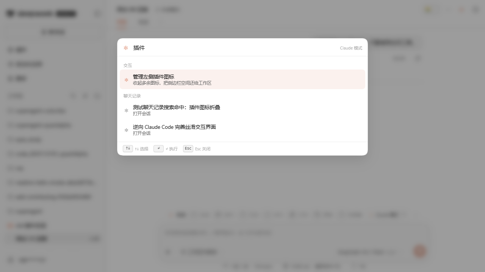
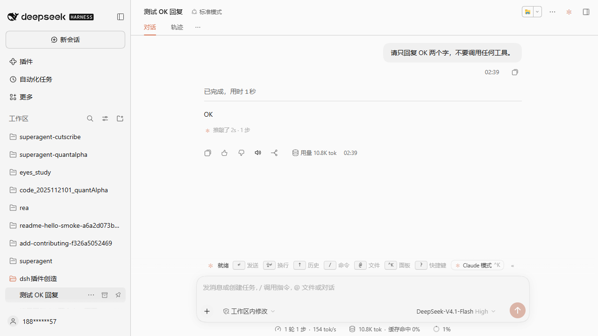
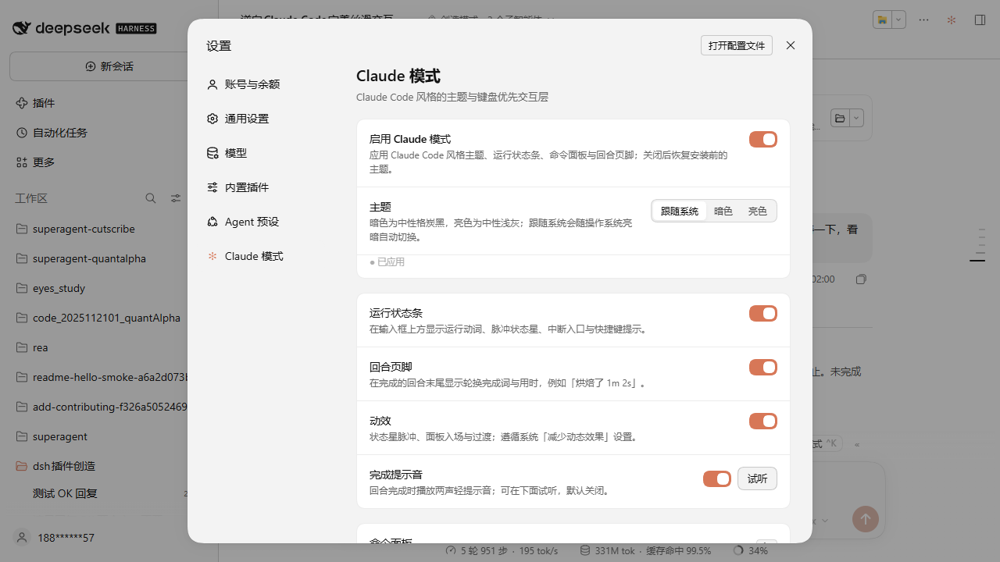
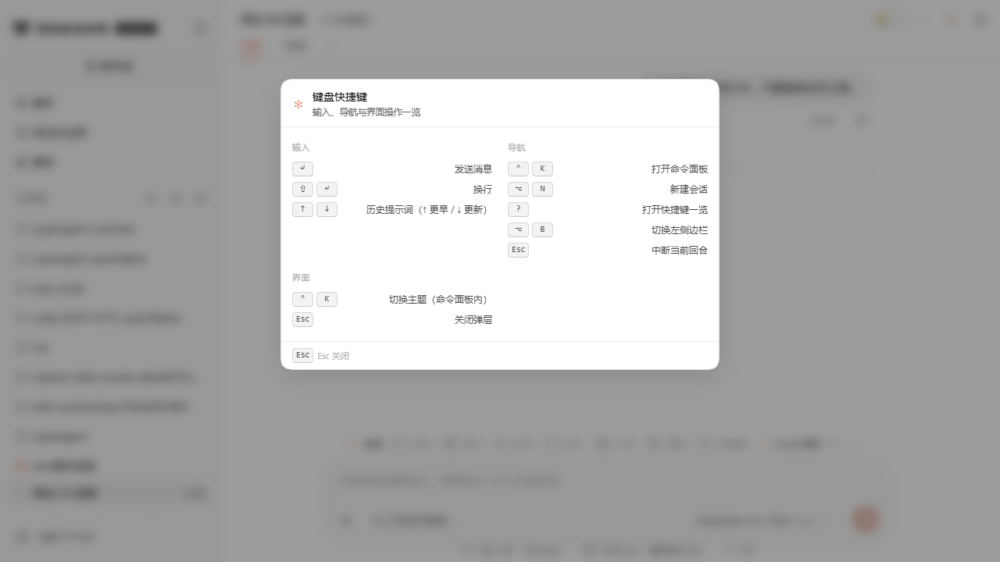
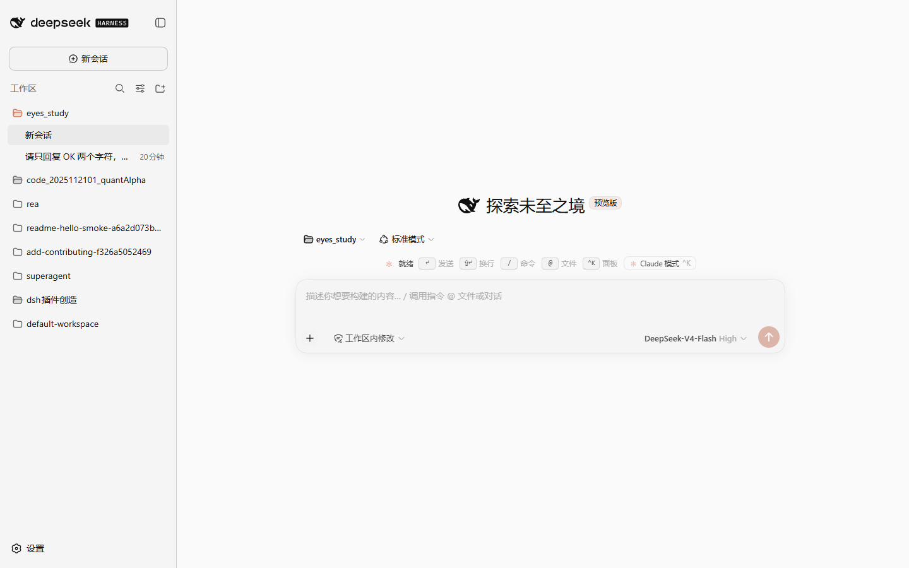
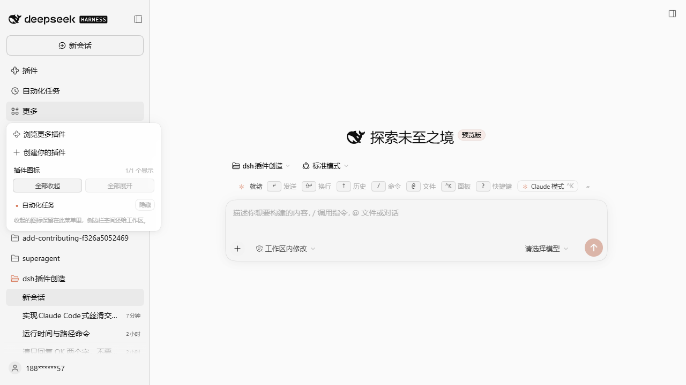
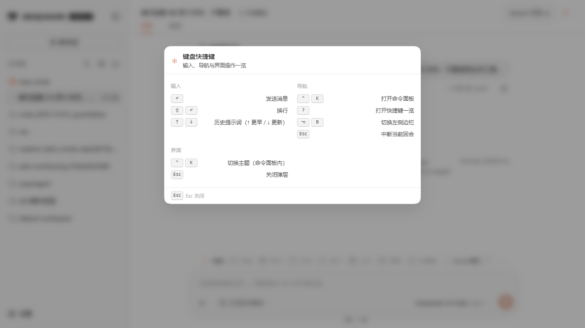
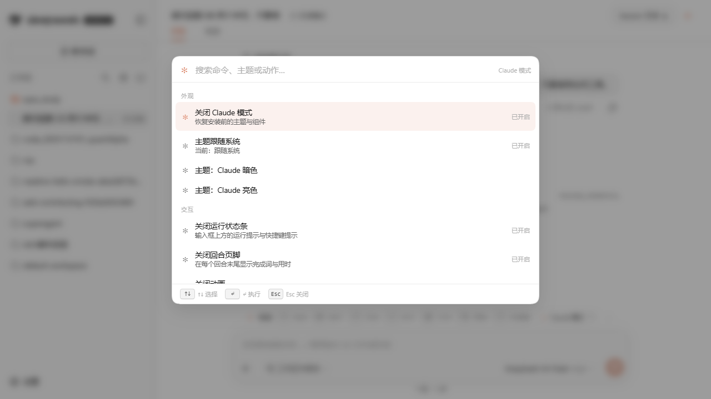

# Claude 模式（dsh-claude-mode）

一个 DeepSeek Harness **纯插槽实现**的 Claude Code 风格交互层：中性灰 + 陶土橙双主题、脉冲状态星、命令面板、轮换完成词页脚与键盘优先操作。不修改宿主文件、不替换应用根节点；关闭或卸载后主题与组件自动还原。

0.5.0 新增四项交互：命令面板内的聊天记录搜索、助手回复朗读、回合完成提示音与 `Alt+N` 新建会话。设计说明见 [docs/DESIGN.md](docs/DESIGN.md)。

> 独立实现：基于 DeepSeek Harness 的公开插槽与服务构建，不包含其他产品的源码、商标、图标或美术资源。配色与交互为本插件的展示层设计，与 Anthropic 无隶属关系。详见 [NOTICE](NOTICE)。



## 交付内容

| 能力 | 落点 | 行为 |
| --- | --- | --- |
| 双主题 | `theme.overrideTokens` 令牌层 | 中性炭黑 / 中性浅灰两套约 200 个 `--dsw-*` 令牌。品牌色 `#d77757`、用户消息块 `#373737/#f0f0f0`、输入区 `#262626/#f5f5f5`、选中 `#264f78/#b4d5ff`、success/error/warning 与 diff 行/词色均来自插件的统一设计令牌；只覆盖令牌，不碰宿主 CSS。 |
| 运行状态条 | `conversation.input.dock` | 空闲时提示 `↵ 发送 · ⇧↵ 换行 · ↑ 历史 · / 命令 · @ 文件 · ⌃K 面板 · ? 快捷键`；运行时显示 `✻ <动词>… (Esc 中断 · 12s · 工具运行 3s)`：6 帧 Unicode 星形以 2 秒往返脉冲（100ms 刷新），并读取 Chat 快照显示当前工具运行时长。 |
| 提示词历史 | 运行条 keydown + 命令面板 | 输入框为空时 `↑` 逐条召回历史提示词、`↓` 回到较新/恢复草稿（读取 Chat 快照的 user/steering 节点，去重、最新优先）。`⌃K` 面板新增「历史提示」分组，最近 12 条可模糊搜索，选中即回填输入框。 |
| 快捷键一览 | `shell.overlay` | 输入框为空时按 `?`（或面板动作）打开快捷键表：输入 / 导航 / 界面三组；`Esc` 或点遮罩关闭。只有空输入才接管。新增 `Alt+N` 新建会话行。 |
| 聊天记录搜索 | `sessions.search` + 命令面板 | 在 `⌃K` 输入 ≥2 个字符时防抖调用宿主的会话全文索引，命中结果进入「聊天记录」分组，显示 snippet，`↵` 打开对应会话；`Alt`/关闭会中止请求，12 秒无响应自动结束加载态。宿主的 `session-query-sqlite` 默认 `openAt: never`，只有部署启用索引时才会返回结果；关闭时该分组安静缺席。 |
| 助手回复朗读 | `conversation.chat.assistant-actions` | 每条已定稿助手消息的操作条新增扬声器按钮：用 Web Speech API 朗读该消息正文，再点切换为「停止朗读」；中文/英文跟随界面语言，长回复按句子切成 ≤1200 字符的 utterance，逐段排队；不支持语音的浏览器不渲染按钮。 |
| 完成提示音 | 运行条状态迁移 + 设置页 | 回合从运行中结束且开关打开时，播放两声 WebAudio 轻提示（E5→B5），窗口失焦也容易听见；默认关闭，设置页可试听，命令面板可开关。播放失败被完全吞掉，不影响回合。 |
| 新建会话快捷键 | `uiWorkspace.startSession` + 全局键位 | `Alt+N` 在任意非模态界面打开空白会话，等价于命令面板「新建会话」；快捷键表与设置页都列出该键位。 |
| 左侧边栏折叠 | `layout` 服务 | 运行条 `«` 按钮、命令面板「切换左侧边栏」、`Alt+B` 三种入口调用 `ctx.layout.toggleSidebar()`；折叠后由宿主渲染 56px 控制轨，不占对话宽度。 |
| 插件图标折叠 | `sidebar.panellist.actions` | 工作区上方的插件图标太多会挤压会话列表。在侧边栏「更多」菜单里新增「插件图标」分组：逐个「显示/隐藏」、一键「全部收起 / 全部展开」，并显示 `N/M 个显示`；被收起的图标仍保留在该菜单中，随时可恢复。命令面板也提供「管理左侧插件图标」入口。 |
| 命令面板 | `shell.overlay` | `Ctrl+K` / `⌘K` 打开：模糊搜索、分组（外观/交互/会话/聊天记录/历史）、↑↓·Tab/Enter/Esc、悬停与点击、遮罩关闭。动作含开关模式、三档主题、状态条/页脚/动效/提示音开关、侧边栏切换、插件图标管理、快捷键一览、中断运行、新建会话；输入两字以上同时搜索宿主聊天记录。 |
| 回合页脚 | `conversation.chat.turnTail` | 完成后显示 `✻ 烘焙了 1m 2s · 3 步`；完成词在 `烘焙/酿造/搅拌/推敲/烹饪/咀嚼/煸炒/打磨`（中文）或 `Baked/Brewed/Churned/Cogitated/Cooked/Crunched/Sautéed/Worked`（英文）中按轮次稳定轮换。兼容较新的 list 槽与旧版 chain 槽。 |
| 会话标题栏按钮 | `conversation.session.header.utilities` | 右上角 `✻` 按钮打开命令面板，运行中显示强调色。 |
| 设置页 | `settings.section` + `settings.section.icon` | 「Claude 模式」分节：总开关、主题三档、状态条/回合页脚/动效/完成提示音开关、提示音试听、快捷键说明、恢复默认、关于与版本。 |
| 动效 | 组件级 CSS/JS | 状态星逐帧脉冲、面板入场、开关/分段过渡；遵守 `prefers-reduced-motion` 与「动效」开关（关闭后状态星固定为 `✻`）。 |



## 安装

在 DSH 会话中让智能体安装本地目录包：

```text
plugin_manager install_bundle，target = <本仓库的绝对路径>
```

安装会写入当前 profile（默认 `desktop`），并在 Plugin Manager 的「已安装插件」中出现「Claude 模式」。刷新 Web GUI（桌面端重新载入窗口）后生效；卸载后主题和全部组件自动移除。

也可以把该目录作为普通 npm 包通过 profile 的 bundles 引入（`dsh.bundle.patch` + `dsh.client` 均已声明）。

## 使用

- `Ctrl+K` / `⌘K`：命令面板；输入两个以上字符即可搜索聊天记录。
- `Alt+N`：新建空白会话。
- 助手消息操作条上的扬声器：朗读该条回复，再点停止。
- 标题栏右上角 `✻`：命令面板。
- 运行状态条的 `Esc 中断`：取消当前回合，保留已完成工具结果与排队消息。
- 设置 → Claude 模式：全部开关、主题三档、完成提示音试听、恢复默认。
- 主题「跟随系统」会随操作系统亮暗切换（暗→中性炭黑，亮→中性浅灰）。

















## 设计原则

1. **只用官方扩展点**：`theme` 服务令牌层、`slots` 的 `conversation.input.dock` / `conversation.chat.turnTail` / `conversation.chat.assistant-actions` / `conversation.session.header.utilities` / `shell.overlay` / `sidebar.panellist.actions` / `settings.section`（+ icon）、`sessions.search` 与 `uiWorkspace` 服务、`locale` 服务。没有覆盖任何宿主已占用的 keyed 槽，没有改宿主包。
2. **可逆**：主题是令牌覆盖层，关闭开关立即移除并恢复安装前偏好；组件全部随插件上下文销毁。
3. **不抢对话视图**：对话流、工具卡、审批、输入、队列都由宿主渲染；插件只在分配的座位上增量渲染，所以宿主升级不会把插件变成编辑器。
4. **可访问**：命令面板 `role="dialog"` + `aria-modal`，开关 `role="switch"` + `aria-checked`，分段控件 `aria-pressed`，脉冲遵循 reduced-motion，焦点可见环，完整键盘操作。
5. **无品牌资产**：状态星是 Unicode `✻`（U+273B）文本字形；不含 Anthropic 图标/字体/截图。

## 已知边界

- **不替换对话视图**：本插件不接管 `conversation.view`，思考块、工具卡、diff、审批等仍使用宿主实现（这也保证了回滚与升级安全）。
- **审批面板会临时接管输入区**：宿主显示审批/提问卡时，其下的运行状态条可能被隐藏；审批卡自身提供允许/拒绝与停止操作。
- **`?` 的接管条件**：只有输入框聚焦且为空时按 `?` 才打开快捷键一览；输入框已有内容时 `?` 仍是普通问号。`Ctrl+R`（重载）与 `Ctrl+S`（保存）不被劫持，历史搜索放在 `⌃K` 面板内。
- **侧边栏折叠依赖宿主 `layout` 服务**：服务缺席时运行条的 `«` 按钮自动隐藏，面板动作降级为无操作。
- **插件图标折叠依赖宿主的面板固定能力**：DSH 0.2.x 通过 `sidebar.panellist.actions` 暴露面板显示状态与切换回调，插件只在「更多」菜单里增加管理分组；更老的宿主没有该槽位时整个分组静默缺席。宿主内置的「更多」菜单本来不提供图标固定操作，这是该功能的补充而非替换。
- **聊天记录搜索依赖宿主全文索引**：`sessions.search` 只有在部署把 `session-query-sqlite` 的 `openAt` 从 `never` 改为 `first-search`/`startup` 后才返回结果（DSH 默认关闭，Web 侧栏搜索只匹配标题与工作区名）。插件在关闭时安静降级，不假装有结果；首次建索引期间会显示「正在搜索聊天记录…」，最迟 12 秒收起加载态。
- **朗读依赖浏览器语音合成**：无 `speechSynthesis` 的宿主不显示按钮；音色、语速由操作系统/浏览器决定，插件只选择与界面语言匹配的 voice。切换消息或卸载时会立即取消朗读。
- **完成提示音默认关闭**：避免在共享环境突然出声；WebAudio 被浏览器策略挂起时静默失败，不影响回合。
- **`Alt+N` 与宿主/系统键位冲突时以宿主为准**：插件使用捕获阶段监听，但只要事件已被宿主处理就不再拦截。
- **localStorage 作用域**：设置保存在 Web GUI 的 origin 下。桌面端 origin 固定，正常持久化；以 `dsh web` 启动且端口变化时，设置按 origin 重置。
- **主题层依赖 `theme` 服务**：若某 profile 未启用主题插件，插件其余组件仍可用，但颜色层不生效。

## 开发

```bash
npm run build:client                   # 由 src/client/*.js 生成 client.js
npm run check                          # 语法检查 + bundle 是否最新
npm test                               # 31 个单测（令牌、i18n、设置、排序/分组、动词池、帧序列、活动判定、历史召回、聊天搜索映射、朗读文本/分块、快捷键表、插件图标管理、组件渲染）
node --check index.js && node --check client.js
```

目录结构：

```text
index.js                 Host 半（空实现，仅让 bundle 行可管理）
cordis.patch.yml         bundle 行
client.js                生成的浏览器 bundle（window.__ModuleLoader__）
src/client/00-head.js    bundle 头（factory 包装）
src/client/01-theme.js   两套完整 --dsw-* 令牌包
src/client/02-state.js   i18n、设置存储、动词/完成词池、状态星帧、调色板通道、格式化
src/client/03-styles.js  作用域化 CSS（.ccm-*）
src/client/04-components.js  状态条/标题按钮/回合页脚/朗读/命令面板/设置页
src/client/05-apply.js   主题层与槽位注册（含旧版 chain 槽回退）
src/client/99-tail.js    bundle 尾
locale/{zh,en}.json      插件管理器显示元数据
docs/DESIGN.md           设计说明与交互分层
docs/VERIFICATION.md     验收记录（环境、矩阵、截图、边界）
```

## 兼容性

- 在 **DSH 0.2.2-rc.1**（Desktop）与 **0.1.2-rc.1**（`dsh web`）验证通过；回合页脚在两种槽位声明下都可注册。
- 依赖的插槽/服务均为官方公开扩展点；宿主若调整槽位名或服务名，插件会降级（对应组件不显示）而不是破坏宿主。

## 许可

MIT。交互与视觉为独立实现；「Claude」相关名称为描述性引用，见 [NOTICE](NOTICE) 与 [设计说明](docs/DESIGN.md)。
